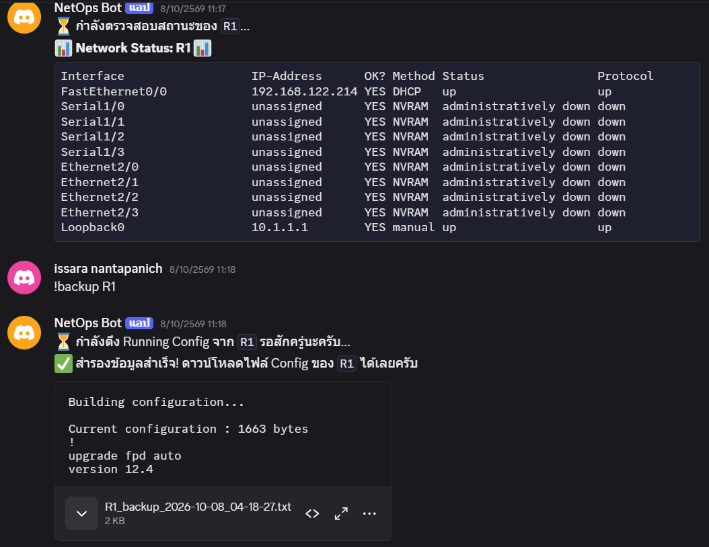

# NetOps Discord Bot

A ChatOps tool that lets you check the status of a Cisco IOS router and back up its configuration directly from Discord. Built with Python, Netmiko and discord.py, and tested on a router in a GNS3 lab.

## Features

- `!status <router>`: shows `show ip interface brief` output in the chat
- `!backup <router>`: pulls the running-config over SSH and sends it as a timestamped `.txt` file
- One-shot interface alert via Discord webhook (`discord_alert.py`)
- Pushes configuration commands to the router and saves to startup-config (`config_router.py`)
- Credentials and tokens are kept in a `.env` file, not in the code

## Demo



## Project progression

The project was built step by step, from a basic SSH connection to a full chat-driven bot.

| Step | File | What it does |
|------|------|--------------|
| 1 | `get_router_info.py` | Connects to R1 over SSH and prints interface status |
| 2 | `discord_alert.py` | Parses FastEthernet0/0 IP and status, posts an alert to Discord via webhook |
| 3 | `config_router.py` | Sends a set of config commands (Loopback0) and saves the configuration |
| 4 | `backup_config.py` | Saves the running-config to a timestamped file |
| 5 | `netops_bot.py` | Discord bot with `!status` and `!backup` commands |

`config.py` loads settings from `.env` and is shared by all scripts.

## How it works

```
Discord user --(!status R1 / !backup R1)--> netops_bot.py (discord.py)
                                                  |
                                                  | SSH (Netmiko)
                                                  v
                                       Cisco IOS router R1 (GNS3)
```

## Tech stack

Python, discord.py, Netmiko (SSH), python-dotenv, requests, Cisco IOS, GNS3

## Setup

1. Clone the repository and create a virtual environment:

   ```bash
   git clone https://github.com/<your-username>/netops-discord-bot.git
   cd netops-discord-bot
   python -m venv venv
   source venv/bin/activate      # Windows: venv\Scripts\activate
   pip install -r requirements.txt
   ```

2. Create your settings file and fill in your own values:

   ```bash
   cp .env.example .env          # Windows: copy .env.example .env
   ```

3. In the [Discord Developer Portal](https://discord.com/developers/applications), create a bot, copy its token into `.env`, and turn on **Message Content Intent**. Invite the bot to your server.

4. Make sure the router is reachable and has SSH enabled, then run:

   ```bash
   python netops_bot.py
   ```

## Usage

In a Discord channel where the bot is present:

```
!status R1
!backup R1
```

Run the other scripts directly, for example `python get_router_info.py`.

## Security notes

- Never commit `.env`. It is listed in `.gitignore`.
- Config backups (`*_backup_*.txt`) are also ignored because they can contain sensitive settings.
- If a token or password is ever pushed by mistake, change it immediately.
- This project was tested in a lab environment. Use SSH (not Telnet) and strong credentials on real devices.

## Limitations and next steps

- Only one router (R1) is configured, but `ROUTERS` in `config.py` supports adding more.
- Continuous monitoring (checking interfaces on a schedule and alerting only on changes) is not implemented yet.
- Long command output may exceed Discord's 2000-character message limit.
- Netmiko calls are blocking; running them in a thread would keep the bot responsive during long commands.

## Author

Issara Nantapanich, Computer Engineering student, Khon Kaen University
